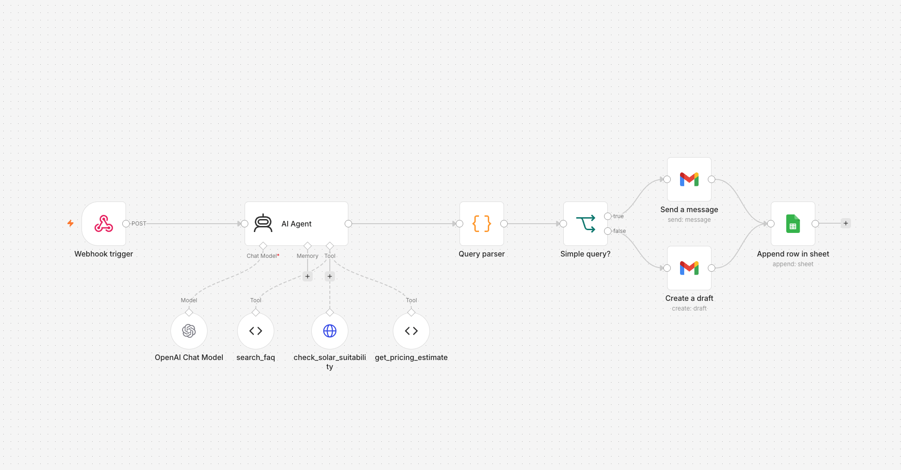

# Brightroof customer service agent (n8n)

An AI customer service agent built in n8n that answers solar subscription enquiries, decides whether each one can be handled automatically, and routes it accordingly: simple questions get an instant email reply, while complaints and anything needing a site visit become a Gmail draft for a human to review. Every enquiry is logged to Google Sheets.


https://github.com/user-attachments/assets/b8cef50b-fe4f-45f8-ae49-708ee31a272d


> Brightroof is a fictional company. The FAQ answers and pricing logic are illustrative and hard-coded.

## Why I built it

Most inbound support volume is repetitive (pricing, contract length, installation), but a meaningful share needs a person: site visits, complaints, edge cases. I wanted to test a pattern where the agent does the first pass on everything and also judges its own confidence, so automation handles the easy volume while anything risky stays human-in-the-loop.

## How it works




1. **Webhook trigger** receives a POST with the customer's name, email and question.
2. **AI Agent** (OpenAI `gpt-4o-mini`) answers using three tools and ends its reply with `COMPLEXITY: SIMPLE` or `COMPLEXITY: COMPLEX`. Complaints and anything needing a site visit or human expertise are COMPLEX, and for those it writes a short holding reply rather than attempting a full answer. The full prompt is in [`prompts/system-prompt.md`](prompts/system-prompt.md).
3. **Query parser** (Code node) reads the tag, removes it from the reply and sets a `complexity` field. It is deliberately fail-safe: if the tag is missing or garbled, the enquiry is treated as complex and goes to a human.
4. **Simple query?** (IF node) routes the enquiry:
   - simple: the reply is emailed to the customer straight away
   - complex: the reply is saved as a Gmail draft for a human to check and send
5. **Append row in sheet** logs name, email, query, response and complexity for every enquiry.

The agent writes only the body of the reply, in plain text. The greeting (first name only) and sign-off come from a fixed email template, so every email is consistent regardless of what the model produces.

### Agent tools

| Tool | Type | What it does |
| --- | --- | --- |
| `search_faq` | Code tool | Keyword lookup against a small FAQ (upfront cost, contract, installation, battery, export, cancellation, etc.) |
| `check_solar_suitability` | HTTP Request tool | Looks up the customer's postcode via the free [postcodes.io](https://postcodes.io) API and returns location data (region, coordinates) for the agent to reason about |
| `get_pricing_estimate` | Code tool | Estimates subscription cost and monthly saving from property type and current energy bill |

## Example requests

A simple enquiry, answered automatically using two tools:

```bash
curl -X POST https://<your-n8n-instance>/webhook/brightroof-agent \
  -H "Content-Type: application/json" \
  -d '{
    "customer_name": "Jane Doe",
    "customer_email": "jane@example.com",
    "query": "I have a detached house in Manchester, M1 1AE, and my bill is £220 a month. What would it cost, and is my area good for solar?"
  }'
```

A complaint, which becomes a draft for human review:

```json
{
  "customer_name": "Tom Hughes",
  "customer_email": "tom@example.com",
  "query": "My panels stopped generating last week and nobody has replied to my emails. I'm very unhappy."
}
```

## Setup

1. In n8n, create a new workflow and choose **Import from File**, then select [`workflows/brightroof-agent.json`](workflows/brightroof-agent.json).
2. Connect three credentials: **OpenAI**, **Gmail (OAuth2)** and **Google Sheets (OAuth2)**.
3. Create a Google Sheet with a tab called `Enquiries` and the columns `customer_name`, `customer_email`, `query`, `agent_response`, `complexity`, `action`. Paste the sheet's ID into the **Append row in sheet** node.
4. Activate the workflow and send a test request to the production webhook URL.

## Repo structure

```
├── README.md
├── workflows/
│   └── brightroof-agent.json   # exported n8n workflow (credentials and IDs removed)
├── prompts/
│   └── system-prompt.md        # AI Agent system prompt
└── assets/
    ├── n8n-workflow.png            # screenshot of the n8n workflow
    └── brightroof-agent-demo.mp4   # demo video
```

## Limitations and next steps

- **Self-assessed routing.** The agent grades its own complexity, so routing is only as good as that judgement, and borderline cases (cancellations, unusual roofs) can go either way. The fail-safe parser limits the damage, but a separate classifier step would be more robust.
- **Output format isn't guaranteed.** In testing, the model occasionally wrote a malformed tag (for example `COMPLEX: COMPLEX`). This is why the parser accepts small variations and defaults to complex.
- **Suitability check is location only.** postcodes.io returns geography, not solar data. A real version would call a solar irradiance source (for example PVGIS) and consider roof orientation.
- **Simple tool logic.** The FAQ tool returns the first keyword match, and the pricing tool takes the first number it finds in its input. Both are placeholders for a proper knowledge base and pricing API.
- **No webhook authentication or input validation.** Production use would need header auth, rate limiting, and checks that name, email and query are present.
- **The `action` column** in the log sheet is not yet populated; the plan is to record whether a reply was sent or drafted.
